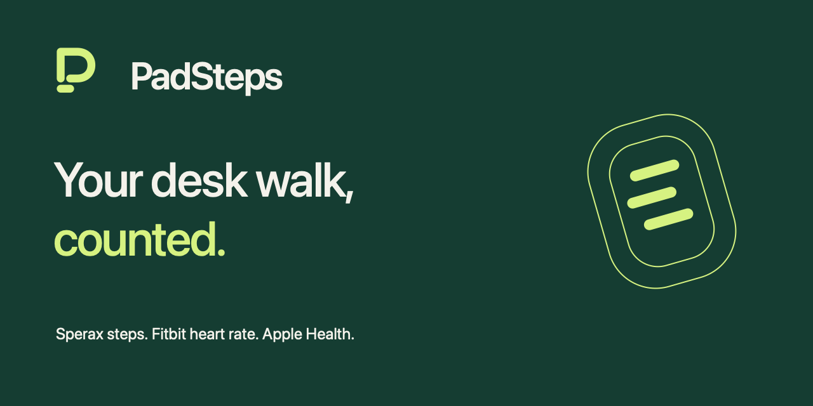

<p align="center"></p>

<p align="center">
  <a href="https://github.com/FGButterLettuce/PadSteps/actions/workflows/checks.yml"></a>
  <a href="LICENSE"></a>
  
  
  
</p>

PadSteps connects the steps your walking pad measures to the health apps you use.
Built for the very specific problem of walking at a standing desk while your
hands stay on a keyboard and your wrist tracker misses the walk.

The Mac records a **Sperax P2 Max** over Bluetooth and reads synced Fitbit
heart-rate history. It keeps Google's detected walking workouts and saves only
uncovered time. A signed local feed transfers the pad's full measurements to the
paired iPhone, which writes the missing step top-up to Apple Health. Bevel uses
Google for workouts and its direct Google steps plus the PadSteps top-up.

**Preview, build it yourself.** Tested with one P2 Max and Fitbit Air setup.
There is no App Store release, hosted account service, or downloadable signed
binary. You supply your own Google OAuth project and Apple signing settings.

## The flow

Pad → Mac → only missing workout time in Google Health.

Mac → signed feed over the trusted iPhone pairing → Apple Health step top-up.

- Start and stop the belt using its remote. The Mac detects the walk.
- Steps come from the pad's counter, not a speed-to-step estimate.
- Heart rate comes from synced Fitbit history; live HR broadcast is unnecessary.
- Each measured pad session has a stable Apple Health import identity. Rechecking it
  adopts the existing step record instead of writing another copy.
- The phone does not create another workout or heart-rate record.

## What works, and what still needs checking

| Capability | Evidence / limitation |
| --- | --- |
| P2 Max telemetry | Status query, framing, checksum, counter fields and motion states verified on physical hardware. |
| Mac recording | Real walks recorded; reconnect preservation and stop detection have automated tests. |
| Google workout gaps + Fitbit HR | A real partially detected walk retained its native workout and added only its two uncovered intervals; readback verified. Existing app-owned overlaps were shortened or removed. |
| Apple Health duplicate protection | Existing step record adopted; a real iPhone app relaunch restored Google access and retained exactly one copy. |
| Separate measured-step feed | Signed feed copied to a real paired iPhone and read back with nine unique session identities; HealthKit application after phone unlock remains a separate check. |
| Background phone execution | Best effort. A matching Google workout was not readable as an Apple Health workout in the original setup, so its observer wake is unproven. App-open catch-up works. |
| Bevel daily steps | Depends on selected sources; fresh-walk daily aggregation is not yet verified. |
| Google daily steps | Adding a workout did **not** credit its summary steps to daily steps in the original tests. The companion uses Apple Health for steps. |

## Get started

You need a Mac with Xcode and Swift 6, XcodeGen, an iPhone for HealthKit writes,
and Google Health API access in your own Google Cloud project. The local step
relay also needs Xcode's `devicectl` and a trusted, Developer Mode iPhone paired
with the Mac. Set `iphone_relay_device_id` using `xcrun devicectl list devices`.
The current relay is a developer-tool transport, not an App Store distribution
solution. A paid Apple
Developer team is the tested signing route; provisioning availability depends on
your account and entitlements.

```sh
git clone https://github.com/FGButterLettuce/PadSteps.git
cd PadSteps
brew install xcodegen
mkdir -p .local
cp config/settings.example.json .local/settings.json
cp config/desktop-oauth.example.json .local/desktop-oauth.json
```

Fill those two local files with your own settings and downloaded desktop OAuth
configuration, then:

```sh
make configure
open PadSteps.xcodeproj
```

Build **PadStepsMac** for your Mac and **PadStepsPhone** for your iPhone. Follow
[SETUP.md](docs/SETUP.md) for OAuth client types, scopes, signing and permissions.
The files in `.local/`, generated projects and copied OAuth resources are ignored
by Git. Never paste tokens or recordings into an issue.

For a credentials-free compile check:

```sh
python3 scripts/configure.py --ci
swift test
```

The compile-only configuration cannot connect to a real Google account.

## Everyday use

1. Keep the Mac awake, near the pad, with PadSteps running. Close SPX Fitness.
2. Wear Fitbit normally and start walking with the pad's remote.
3. Stop with the remote. If PadSteps waits for heart rate, open Google Health on
   the phone and let Fitbit sync.
4. Leave automatic syncing enabled on the iPhone. Open PadSteps for immediate
   catch-up rather than relying on iOS background timing.
5. For `missing-google` mode in Bevel Steps, keep direct Google Health and
   PadSteps enabled. Hide the duplicate Google Health source labeled with your
   iPhone. The top-up is designed for this combined view; Apple Health's merged
   counter may be lower.

Duplicate import protection and cross-source daily aggregation are different
things. A stable walk ID prevents PadSteps importing the same walk twice; it
does not control how another app combines multiple sources.

## Repository layout

```text
apps/macOS/             Bluetooth recorder and Google workout uploader
apps/iOS/               Read-only Google reader and HealthKit steps companion
Sources/PadStepsCore/   Framing, recording, HR coverage and import decisions
Tests/                 Synthetic fixtures and shared-core tests
config/                Public configuration examples only
scripts/               Local configuration and public-tree checks
assets/brand/          Editable mark, wordmark, GitHub header and identity board
docs/                  Setup, architecture, protocol, privacy and branding
```

Protocol access is observational: only a status query is exposed. Motor start,
speed and incline commands are deliberately absent. Compatibility with other
pads has not been established.

See [architecture](docs/ARCHITECTURE.md), [protocol notes](docs/PROTOCOL.md),
[privacy and data boundaries](docs/PRIVACY.md), [contributing](CONTRIBUTING.md),
and [security reporting](SECURITY.md).

Independent community software. Not affiliated with Sperax, Fitbit, Google,
Apple or Bevel. Those names identify compatibility and remain their owners'
trademarks. Code and project-created artwork are offered under [MIT](LICENSE);
third-party dependencies retain their own licenses.

Blocked by an existing exercise? See [overlap review and step comparisons](docs/OVERLAPPING-WORKOUTS.md).

For Bevel with a direct Google Health connection, optional [`missing-google` mode](docs/OVERLAPPING-WORKOUTS.md#two-automatic-bevel-feeds-google-plus-missing-pad-steps) exports only the pad steps missing from Google, revising the same record after later syncs.
