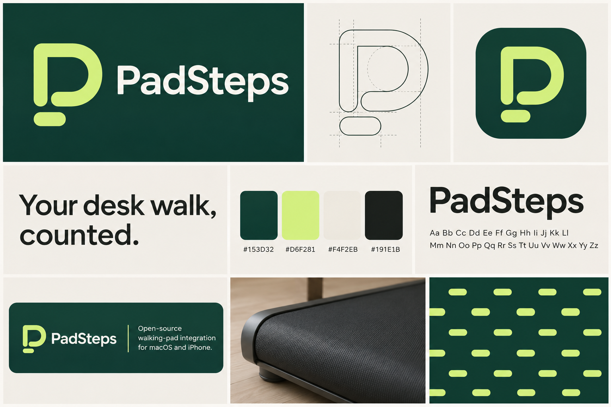

# PadSteps identity

**Your desk walk, counted.**

A small personal tool for an overlooked everyday problem: the walking pad sees
your walk while your wrist sits at the keyboard. The identity should feel calm,
practical and precise, rather than like a competitive sports tracker.

## Mark

The canonical mark is an open belt-loop **P** with a separate lower tread.
The opening and short dash connect the initial to a walking belt and a measured
step. Preserve the geometry and clear space; do not replace it with a footprint,
heart, ring or third-party health logo.

- [Icon SVG](../assets/brand/icon.svg): the mark on a forest tile.
- [Standalone mark SVG](../assets/brand/mark.svg): lime mark on transparency,
  intended for a dark background.
- [Wordmark SVG](../assets/brand/wordmark.svg): horizontal name lockup.
- [GitHub header SVG](../assets/brand/github-hero.svg): editable banner artwork.
- [GitHub/social header PNG](../assets/brand/github-hero.png): 1280 × 640 raster
  version suitable for a repository social-preview image.
- Mac `.icns` and iOS app-icon PNG are in their respective app resources.

## Color and typography

| Role | Color |
| --- | --- |
| Forest | `#153D32` |
| Soft lime | `#D6F281` |
| Warm paper | `#F4F2EB` |
| Graphite | `#191E1B` |

Use forest as the quiet ground and lime for the mark or a short point of
emphasis. Use large, clear system sans-serif type, modestly tight display
spacing and plain language. The SVGs include system/Helvetica/Arial fallbacks;
no proprietary font files are distributed. Native application content retains
the operating system's semantic typography, colors and controls.

## Reproduction

On macOS, run `swift scripts/render_brand.swift` to render app icons and the
raster GitHub header from the project-created geometry. The SVGs are editable
source assets. Do not put private measurements into a promotional screenshot.

The overview board was generated with the built-in imagegen tool using the
canonical icon as a visual reference. It is a brand direction presentation,
not a real app screenshot or evidence of functionality. Its generative rendering
does not replace the SVGs as the source of truth. The exact generation prompt is
preserved in [brand-prompt.txt](brand-prompt.txt).
